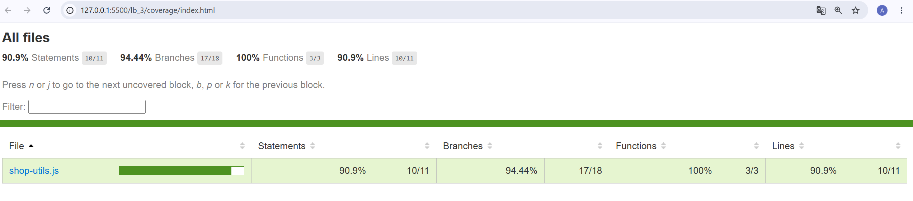
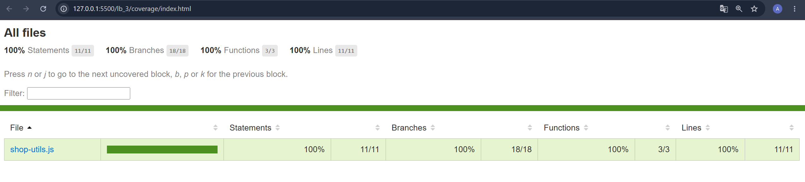

# Лабораторна робота №3

## Модульне тестування програмного коду за допомогою Vitest

**Виконав:** Бондаренко Андрій  
**Група:** 6.1213-пі-2  
**Дата:** 27.10.2026

## Test Object

`src/shop-utils.js`

## Функції

- `calculateDiscount()`
- `validateQuantity()`
- `getShippingCost()`

## Test Design

## calculateDiscount

**Правила (Test Basis):** `price ≥ 0`, `0 ≤ percent ≤ 100`, результат = `price - price × percent / 100`; при некоректних аргументах генерується `Error`.

### Test Condition

- **TCND-01** – розрахунок ціни зі знижкою для типових коректних значень

  Test Data: `price = 100`, `percent = 10`  
  Expected: `90`

- **TCND-02** – знижка на нижній межі діапазону (знижки немає)

  Test Data: `price = 100`, `percent = 0`  
  Expected: `100`

- **TCND-03** – знижка на верхній межі діапазону (товар безкоштовний)

  Test Data: `price = 100`, `percent = 100`  
  Expected: `0`

- **TCND-04** – відмова при від'ємній ціні та повідомлення про помилку

  Test Data: `price = -10`, `percent = 10`  
  Expected: `Error('Price must be a non-negative number')`

Помилки перевірялися через `toThrow()`. Виклик функції обгорнуто в `() => calculateDiscount(...)`, щоб Vitest сам викликав її й перехопив виняток.

## validateQuantity

**Правила (Test Basis):** `quantity` – ціле число, `1 ≤ quantity ≤ 10`.

### Equivalence partitions

| Клас | Опис | Результат |
|---|---|---|
| 1 | `quantity < 1` | false |
| 2 | ціле число від 1 до 10 | true |
| 3 | `quantity > 10` | false |
| 4 | число не є цілим | false |

### Boundary values

Для кожної з двох меж перевіряються три точки: перед межею, на межі та після неї.

| Біля межі | quantity | Результат |
|---|---:|---|
| нижня (1) | 0 | false |
| нижня (1) | 1 | true |
| нижня (1) | 2 | true |
| верхня (10) | 9 | true |
| верхня (10) | 10 | true |
| верхня (10) | 11 | false |

Усі сім наборів даних виконуються одним параметризованим тестом `test.for()`, адже змінюються лише `quantity` та `expected`.

## getShippingCost

### Перевірені гілки

- **Гілка платної доставки** (`0 ≤ total < 1000`)

  Test Data: `total = 999`  
  Обидві умови `if` хибні, виконується фінальний `return 100`.

- **Гілка безкоштовної доставки** (`total ≥ 1000`)

  Test Data: `total = 1000`  
  Перша умова хибна, друга істинна, повертається `0`. Це саме значення на межі.

- **Гілка помилки** (`total < 0`)

  Test Data: `total = -1`  
  Перша умова істинна, генерується `Error('Total must be a non-negative number')`.

## Результати тестування

| Група тестів | Кількість | Result |
|---|---:|---|
| calculateDiscount | 5 | Pass |
| validateQuantity | 7 | Pass |
| getShippingCost | 3 | Pass |

## Coverage

### Початкове покриття (без тесту на некоректний percent)

| Metric | Result |
|---|---:|
| Statements | 90.9% |
| Branches | 94.44% |
| Functions | 100% |
| Lines | 90.9% |

За HTML-звітом непокритим залишився рядок 13 – `throw` для некоректного `percent`. Жоден із початкових тестів не передавав невалідну знижку, тому ця гілка не виконувалась.

### Додатковий тест

- **TCND-05** – відмова при від'ємній знижці та повідомлення про помилку

  Test Data: `price = 100`, `percent = -10`  
  Expected: `Error('Discount must be between 0 and 100')`

### Остаточне покриття

| Metric | Result |
|---|---:|
| Statements | 100% |
| Branches | 100% |
| Functions | 100% |
| Lines | 100% |

## Висновок

У роботі було написано unit tests для трьох функцій `shop-utils.js` у Vitest за схемою AAA. Для `validateQuantity()` тестові дані підбирались за класами еквівалентності та граничними значеннями, а однотипні перевірки об'єднано в один `test.for()`. Усі 15 тестів пройшли успішно.

Звіт Coverage показав 90.9% для Statements і Lines через непокритий рядок 13 (помилка для некоректної знижки). Після додавання одного тесту покриття зросло до 100%. Але така цифра лише означає, що код виконувався, а чи правильні дані й очікування, вона не показує.