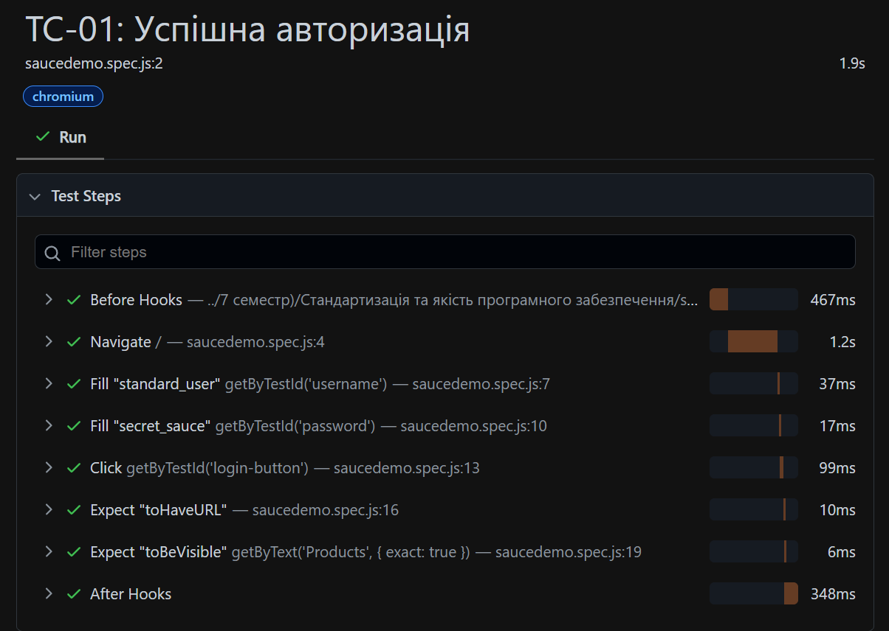
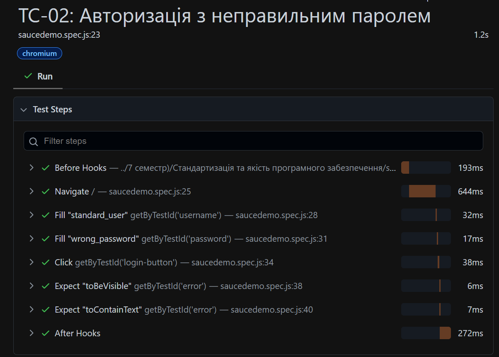
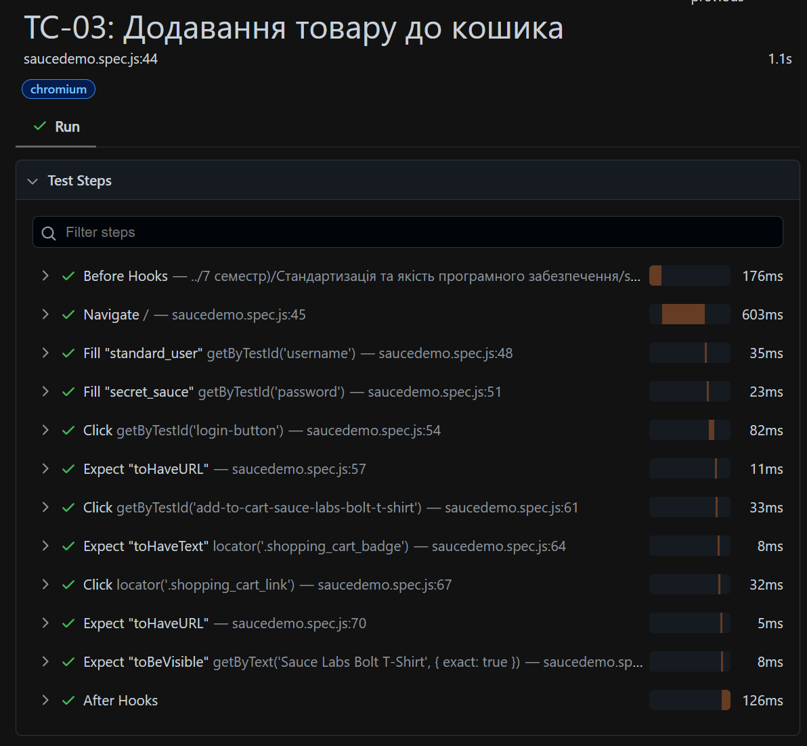
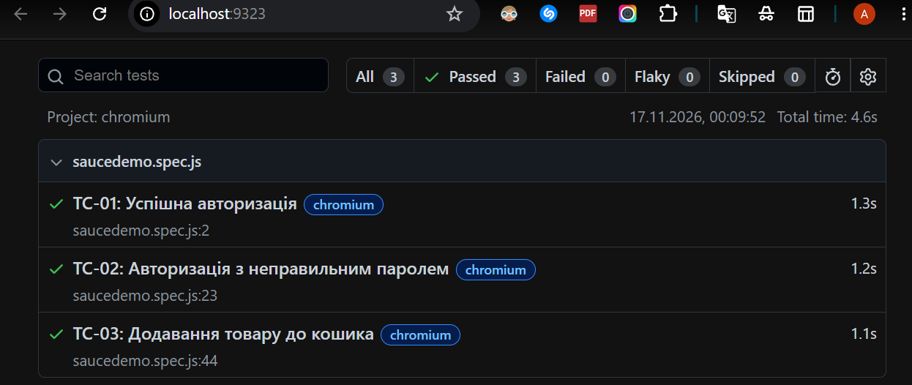

# Лабораторна робота №6

## Автоматизація тестування вебінтерфейсу з використанням Playwright

**Виконав:** Бондаренко Андрій\
**Група:** 6.1213-пі-2\
**Дата виконання:** 17.11.2026

## Середовище тестування
- Мова: JavaScript
- Інструмент: Playwright 1.65.1
- Браузер: Chromium
- Об'єкт тестування: https://www.saucedemo.com/

## Реалізовані тести
| ID | Сценарій | Статус |
|---|---|---|
| TC-01 | Успішна авторизація | Passed |
| TC-02 | Авторизація з неправильним паролем | Passed |
| TC-03 | Додавання товару до кошика | Passed |

## Результати тестування

### TC-01. Успішна авторизація
**Expected Result:**
Після введення правильного логіна та пароля відкривається сторінка каталогу товарів.

**Actual Result:**
Після натискання Login відкрилася сторінка inventory.html, відобразився заголовок Products.

**Status:** Passed

### TC-02. Неправильний пароль
**Expected Result:**
Після введення логіна та неправильного пароля на сторінці відображаеться помилка, що пароль неправильний.

**Actual Result:**
Відобразився блок помилки (`data-test="error"`) з текстом «Epic sadface: Username and password do not match any user in this service». Перехід до каталогу не відбувся.

**Status:** Passed

### TC-03. Додавання товару

**Expected Result:**
Вибраний товар відображається в кошику.

**Actual Result:**
Після додавання індикатор кошика показав '1', після переходу до кошика відображаеться товар

**Status:** Passed

## Підсумок запуску

| ID | Тест | Очікуваний результат | Фактичний результат | Час виконання | Статус |
|---|---|---|---|---|---|
| TC-01 | Успішна авторизація | Відкривається каталог | Каталог відкрився | 1.3s | Passed |
| TC-02 | Неправильний пароль | Повідомлення про помилку | Повідомлення відображено | 1.2s | Passed |
| TC-03 | Додавання товару | Товар є в кошику | Товар відображається | 1.1s | Passed |

Результат: 3 passed, загальний час: 4.6s

## Аналіз результатів

Усі три теста завершились зі статусом Passed, фактичні результати збігаються з очікуваними. Негативний сценарій TC-02 має стан Passed тому що, система відхилила неправльний пароль і показала помилку. 

## Висновок

У ході виконання роботи було ознайомлено з інструментом Playwright, налаштовано конфігурацію `playwright.config.js` (зокрема `testIdAttribute: 'data-test'`), створено окрему директорію `e2e`, яку виключено з запуску Vitest, та автоматизовано три сценарії для SauceDemo: успішну авторизацію, авторизацію з неправильним паролем і додавання товару до кошика. Усі тести пройшли успішно, фактичні результати збігаються з очікуваними. Також було проведено експеримент із неіснуючою назвою товару: тест завершився зі статусом Failed, а збережені скриншот і Trace Viewer дозволили побачити кроки виконання та визначити причину помилки.